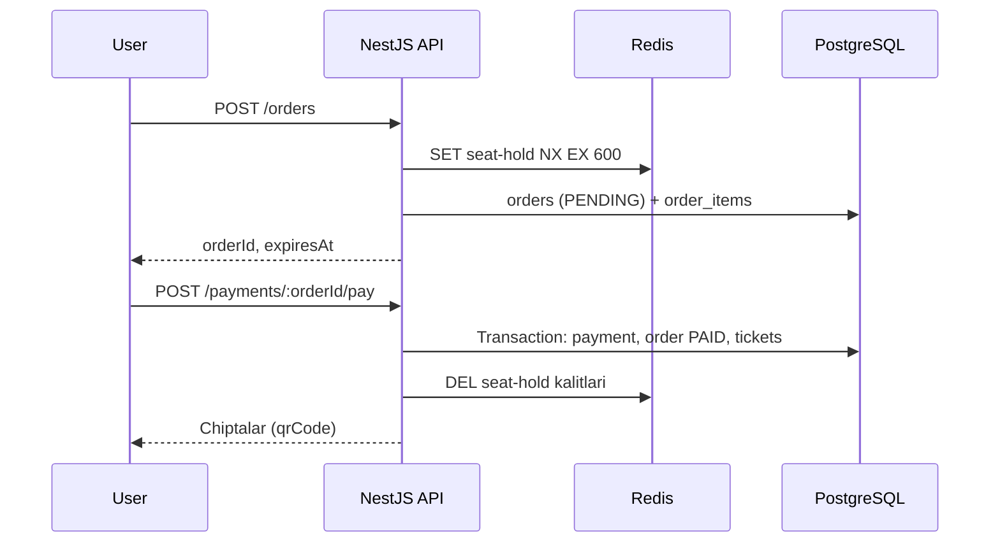
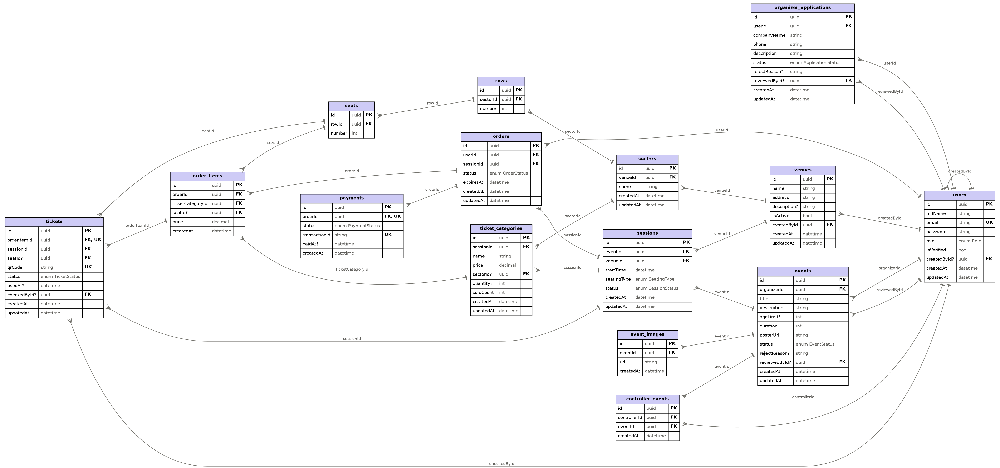

# Chipta sotish platformasi — Backend Texnik-topshiriq

2026-09-18

## 1. Umumiy ma'lumot

Loyiha — iticket.uz ga o'xshash onlayn chipta sotish platformasining backend qismi. Foydalanuvchi tadbir seansini tanlaydi, o'rindiq yoki kategoriya bo'yicha chipta oladi, mock to'lovdan keyin profilida QR kodli chipta paydo bo'ladi, kirishda Controller QR ni tekshiradi.

| Qism | Tanlov |
| --- | --- |
| Framework | NestJS (TypeScript) |
| Arxitektura | Monolit, modullarga bo'lingan |
| Ma'lumotlar bazasi | PostgreSQL |
| ORM | Prisma |
| Kesh va vaqtinchalik band qilish | Redis |
| Fayl yuklash | Multer (lokal disk, `uploads/`) |
| Autentifikatsiya | JWT: access token + refresh token (httpOnly cookie) |
| Parol | bcrypt hash |
| To'lov | Mock (haqiqiy integratsiyasiz) |

Loyiha doirasidan tashqari: promo-kod, refund, sevimlilar, izoh/baho, kategoriya va shahar filtrlari, emailga chipta yuborish.

Ochiq savol: OTP kodni emailga yuborish uchun SMTP kutubxonasi (masalan, nodemailer) kerak bo'ladi — texnologiyalar ro'yxatiga qo'shish jamoa qaroriga bog'liq.

## 2. Rollar va huquqlar

Tizimda 5 ta rol bor: `USER`, `ORGANIZER`, `CONTROLLER`, `ADMIN`, `SUPERADMIN`. Rol `users.role` ustunida saqlanadi va `RolesGuard` + `@Roles()` dekoratori orqali tekshiriladi.

| Rol | Qanday paydo bo'ladi | Asosiy huquqlari |
| --- | --- | --- |
| USER | O'zi ro'yxatdan o'tadi, emailni OTP bilan tasdiqlaydi | Tadbirlarni ko'rish, buyurtma berish, to'lash, o'z chiptalarini ko'rish, Organizer bo'lishga ariza berish |
| ORGANIZER | USER ariza beradi, ADMIN tasdiqlaydi — rol ORGANIZER ga o'zgaradi | Tadbir va seans yaratish (tayyor zallardan tanlab), afisha/galereya yuklash, narx kategoriyalarini belgilash, Controller yaratish va o'z tadbirlariga biriktirish, tadbirni bekor qilish |
| CONTROLLER | ORGANIZER yaratadi (`createdById`) | Biriktirilgan tadbirlarning barcha seanslarida QR kodni tekshirish (check-in) |
| ADMIN | SUPERADMIN yaratadi | Zal, sektor, qator, o'rindiq yaratish; Organizer arizalarini va tadbirlarni tasdiqlash yoki rad etish; tadbirni bekor qilish |
| SUPERADMIN | Seed orqali yaratiladi | ADMIN huquqlari + adminlarni yaratish va o'chirish |

Faqat `isVerified = true` bo'lgan foydalanuvchi tizimga kira oladi. ADMIN, CONTROLLER va SUPERADMIN yaratilganda darhol tasdiqlangan hisoblanadi.

## 3. Modullar va endpointlar

Loyiha 10 ta biznes modul va umumiy (shared) modullardan iborat. Barcha endpointlar `/api` prefiksi bilan ishlaydi; "Public" — tokensiz ochiq.

### 3.1 Auth

| Method | Endpoint | Rol | Tavsif |
| --- | --- | --- | --- |
| POST | /auth/register | Public | fullName, email, password; emailga OTP yuboradi |
| POST | /auth/verify-otp | Public | email + kod; `isVerified = true` |
| POST | /auth/resend-otp | Public | OTP ni qayta yuborish |
| POST | /auth/login | Public | Access token qaytaradi, refresh token cookie'ga yoziladi |
| POST | /auth/refresh | Cookie | Yangi access token |
| POST | /auth/logout | Auth | Refresh cookie'ni tozalaydi |

### 3.2 Users

| Method | Endpoint | Rol | Tavsif |
| --- | --- | --- | --- |
| GET | /users/me | Auth | O'z profili |
| PATCH | /users/me | Auth | fullName, parolni o'zgartirish |
| POST | /admins | SUPERADMIN | Admin yaratish |
| GET | /admins | SUPERADMIN | Adminlar ro'yxati |
| DELETE | /admins/:id | SUPERADMIN | Adminni o'chirish |
| POST | /controllers | ORGANIZER | Controller yaratish |
| GET | /controllers | ORGANIZER | O'zi yaratgan controllerlar |
| DELETE | /controllers/:id | ORGANIZER | Controllerni o'chirish |

### 3.3 Organizer Applications

| Method | Endpoint | Rol | Tavsif |
| --- | --- | --- | --- |
| POST | /organizer-applications | USER | Ariza berish (companyName, phone, description) |
| GET | /organizer-applications/me | USER | O'z arizasi holati |
| GET | /organizer-applications?status= | ADMIN | Arizalar ro'yxati |
| PATCH | /organizer-applications/:id/approve | ADMIN | Tasdiqlash, user roli ORGANIZER bo'ladi |
| PATCH | /organizer-applications/:id/reject | ADMIN | Rad etish (rejectReason) |

### 3.4 Venues

| Method | Endpoint | Rol | Tavsif |
| --- | --- | --- | --- |
| POST | /venues | ADMIN | Zal yaratish |
| GET | /venues | ADMIN, ORGANIZER | Zallar ro'yxati |
| GET | /venues/:id | ADMIN, ORGANIZER | Zal + sektor/qator/o'rindiq sxemasi |
| PATCH / DELETE | /venues/:id | ADMIN | Tahrirlash, o'chirish |
| POST | /venues/:id/sectors | ADMIN | Sektor qo'shish |
| POST | /sectors/:id/rows | ADMIN | Qator qo'shish: `number` + `seatsCount`, o'rindiqlar avtomatik yaratiladi |
| DELETE | /sectors/:id, /rows/:id | ADMIN | O'chirish |

### 3.5 Events

| Method | Endpoint | Rol | Tavsif |
| --- | --- | --- | --- |
| POST | /events | ORGANIZER | multipart: ma'lumotlar + `poster`; status PENDING |
| POST | /events/:id/images | ORGANIZER | multipart: galereya rasmlari |
| DELETE | /events/:id/images/:imageId | ORGANIZER | Rasmni o'chirish |
| PATCH | /events/:id | ORGANIZER | O'z tadbirini tahrirlash |
| GET | /events | Public | Faqat APPROVED tadbirlar, pagination, Redis kesh |
| GET | /events/:id | Public | Tadbir + galereya + seanslar |
| GET | /events/my | ORGANIZER | O'z tadbirlari (barcha statuslar) |
| GET | /admin/events?status= | ADMIN | Moderatsiya ro'yxati |
| PATCH | /events/:id/approve, /reject | ADMIN | Tasdiqlash yoki rad etish |
| PATCH | /events/:id/cancel | ORGANIZER (o'ziniki), ADMIN | Tadbirni bekor qilish |

Ochiq savol: APPROVED tadbir tahrirlansa, u qayta PENDING (moderatsiya) holatiga tushadimi?

### 3.6 Sessions va Ticket Categories

| Method | Endpoint | Rol | Tavsif |
| --- | --- | --- | --- |
| POST | /events/:id/sessions | ORGANIZER | venueId, startTime, seatingType + kategoriyalar ro'yxati; SEATED da har bir sektorga faqat bitta kategoriya (takrorlansa 409) |
| GET | /events/:id/sessions | Public | Tadbir seanslari |
| GET | /sessions/:id/seats | Public | SEATED: har bir o'rindiq holati (FREE, HELD, SOLD) va narxi |
| GET | /sessions/:id/categories | Public | Kategoriyalar, GENERAL uchun qolgan soni |
| PATCH | /ticket-categories/:id | ORGANIZER | Narx yoki sonini o'zgartirish (sotuv boshlanmagan bo'lsa) |
| PATCH | /sessions/:id/cancel | ORGANIZER, ADMIN | Seansni bekor qilish |

### 3.7 Orders

| Method | Endpoint | Rol | Tavsif |
| --- | --- | --- | --- |
| POST | /orders | USER | sessionId + items (SEATED: seatId lar; GENERAL: ticketCategoryId + quantity), jami ≤ 5 ta |
| GET | /orders/me | USER | O'z buyurtmalari |
| GET | /orders/:id | USER | Buyurtma tafsiloti |
| PATCH | /orders/:id/cancel | USER | PENDING buyurtmani bekor qilish, band joylar bo'shaydi |

### 3.8 Payments (mock)

| Method | Endpoint | Rol | Tavsif |
| --- | --- | --- | --- |
| POST | /payments/:orderId/pay | USER | Mock to'lov; body'dagi `success` bayrog'i orqali muvaffaqiyatsiz holatni ham sinash mumkin |

### 3.9 Tickets

| Method | Endpoint | Rol | Tavsif |
| --- | --- | --- | --- |
| GET | /tickets/me | USER | O'z chiptalari (qrCode bilan) |
| GET | /tickets/:id | USER | Bitta chipta |

### 3.10 Controllers / Check-in

| Method | Endpoint | Rol | Tavsif |
| --- | --- | --- | --- |
| POST | /controller-events | ORGANIZER | controllerId + eventId: biriktirish |
| DELETE | /controller-events/:id | ORGANIZER | Biriktirishni olib tashlash |
| GET | /check-in/events | CONTROLLER | Biriktirilgan tadbirlar |
| POST | /check-in | CONTROLLER | qrCode ni tekshirish, chipta USED bo'ladi |

### 3.11 Shared modullar

`PrismaModule` (global), `RedisModule` (global), `UploadModule` (Multer konfiguratsiyasi), `common/` papkasi: `JwtAuthGuard`, `RolesGuard`, `@Roles()`, `@CurrentUser()`, global `ValidationPipe`, exception filter.

## 4. Asosiy biznes jarayonlar

Xarid 3 qadamdan iborat: buyurtma (joy band qilinadi) → mock to'lov → chipta yaratiladi. Band qilish muddati 10 daqiqa (`.env` dagi `ORDER_HOLD_MINUTES`).

### 4.1 Buyurtma yaratish (POST /orders)

1. Seans ACTIVE, tadbir APPROVED va `startTime` kelajakda ekani tekshiriladi.
2. Jami chiptalar soni 5 tadan oshmasligi tekshiriladi.
3. **SEATED:** har bir `seatId` shu seans zaliga tegishli va `tickets` da sotilmagan bo'lishi kerak. Keyin Redis'da `SET seat-hold:{sessionId}:{seatId} {orderId} NX EX 600` bajariladi. Bitta kalit ham band bo'lsa, shu so'rovda qo'yilgan kalitlar o'chiriladi va 409 Conflict qaytadi.
4. **GENERAL:** qolgan soni = `quantity − soldCount − PENDING (muddati o'tmagan) buyurtmalardagi soni`. Yetmasa 409.
5. `orders` (PENDING, `expiresAt = now + 10 daqiqa`) va `order_items` (narx `ticket_categories.price` dan olinadi) yaratiladi.

### 4.2 Mock to'lov (POST /payments/:orderId/pay)

1. Buyurtma shu userga tegishli va PENDING ekani tekshiriladi. `expiresAt` o'tgan bo'lsa, buyurtma EXPIRED qilinadi va 410 qaytadi.
2. `success = false` bo'lsa: payment FAILED yoziladi, buyurtma PENDING qoladi (muddat ichida qayta urinish mumkin).
3. `success = true` bo'lsa, bitta Prisma transaction ichida: payment SUCCESS (`transactionId` generatsiya), order PAID, har bir order_item uchun ticket (ACTIVE, `qrCode` = noyob UUID), GENERAL uchun `soldCount` oshiriladi.
4. Transactiondan keyin Redis'dagi `seat-hold` kalitlari o'chiriladi.

### 4.3 Buyurtmani bekor qilish va muddati o'tishi

User PENDING buyurtmani bekor qilsa, status CANCELLED bo'ladi va Redis kalitlari o'chiriladi. Muddati o'tgan buyurtmalar to'lov urinishida yoki ro'yxat so'ralganda EXPIRED ga o'tkaziladi; Redis kalitlari TTL bilan o'zi o'chadi.

### 4.4 Check-in (POST /check-in)

1. `qrCode` bo'yicha chipta topiladi, topilmasa 404.
2. Controller chipta seansining tadbiriga `controller_events` orqali biriktirilgani tekshiriladi, aks holda 403.
3. Chipta ACTIVE bo'lishi kerak: USED bo'lsa "allaqachon ishlatilgan" (409), CANCELLED bo'lsa "bekor qilingan" (400).
4. Chipta USED bo'ladi, `usedAt` va `checkedById` yoziladi.

### 4.5 Bekor qilish (tadbir yoki seans)

Tadbir CANCELLED bo'lsa, uning barcha seanslari CANCELLED bo'ladi. Seans CANCELLED bo'lsa, uning barcha ACTIVE chiptalari CANCELLED bo'ladi, PENDING buyurtmalari esa CANCELLED qilinadi. Pul qaytarish (refund) loyiha doirasida yo'q.

## 5. Redis va Multer qoidalari

Redis uch vazifani bajaradi: OTP saqlash, o'rindiqni vaqtincha band qilish va tadbirlar ro'yxatini keshlash.

| Kalit | Qiymat | TTL | Qachon o'chadi |
| --- | --- | --- | --- |
| `otp:{email}` | 6 xonali kod (hash) | 5 daqiqa | Tasdiqlangach yoki TTL |
| `otp-attempts:{email}` | Noto'g'ri urinishlar soni (≤ 5) | 5 daqiqa | TTL |
| `seat-hold:{sessionId}:{seatId}` | orderId | 10 daqiqa | To'lov, bekor qilish yoki TTL |
| `cache:events:list:{page}:{limit}` | JSON ro'yxat | 60 soniya | Tadbir tasdiqlansa, tahrirlansa, bekor qilinsa (`cache:events:*` tozalanadi) |
| `cache:events:{id}` | JSON tadbir | 60 soniya | Shu tadbir o'zgarsa |

`GET /sessions/:id/seats` o'rindiq holatini hisoblashda `tickets` (SOLD) va `seat-hold:{sessionId}:*` kalitlarini (HELD) birlashtiradi.

**Multer (faqat tadbir rasmlari):**

- Saqlash joyi: `uploads/events/`, fayl nomi `{uuid}.{ext}`; statik tarzda `/uploads` orqali beriladi.
- Ruxsat etilgan turlar: jpg, jpeg, png, webp. Maksimal hajm: 5 MB.
- `poster` — tadbir yaratishda bitta fayl (majburiy); galereya — bir so'rovda ko'pi bilan 10 ta fayl.
- Rasm yoki tadbir o'chirilganda fayl diskdan ham o'chiriladi.

## 6. Ma'lumotlar bazasi

Baza 15 ta jadvaldan iborat, barcha PK lar UUID. To'liq ustunlar `schema.prisma` va `ticket-db.dbml` fayllarida, ER diagramma `erd.png` faylida.

| # | Jadval | Asosiy bog'lanishlar | Muhim cheklovlar |
| --- | --- | --- | --- |
| 1 | users | createdById → users | email unique |
| 2 | organizer_applications | userId, reviewedById → users | |
| 3 | venues | createdById → users | |
| 4 | sectors | venueId → venues | |
| 5 | rows | sectorId → sectors | (sectorId, number) unique |
| 6 | seats | rowId → rows | (rowId, number) unique |
| 7 | events | organizerId, reviewedById → users | |
| 8 | event_images | eventId → events | onDelete Cascade |
| 9 | sessions | eventId → events, venueId → venues | |
| 10 | ticket_categories | sessionId → sessions, sectorId → sectors | (sessionId, sectorId) unique |
| 11 | controller_events | controllerId → users, eventId → events | (controllerId, eventId) unique |
| 12 | orders | userId → users, sessionId → sessions | |
| 13 | order_items | orderId → orders, ticketCategoryId, seatId | onDelete Cascade |
| 14 | payments | orderId → orders | orderId unique, transactionId unique |
| 15 | tickets | orderItemId, sessionId, seatId, checkedById | orderItemId unique, qrCode unique, (sessionId, seatId) unique |

**Enumlar:**

- `Role`: USER, ORGANIZER, CONTROLLER, ADMIN, SUPERADMIN
- `ApplicationStatus`: PENDING, APPROVED, REJECTED
- `EventStatus`: PENDING, APPROVED, REJECTED, CANCELLED
- `SeatingType`: SEATED, GENERAL
- `SessionStatus`: ACTIVE, CANCELLED
- `OrderStatus`: PENDING, PAID, CANCELLED, EXPIRED
- `PaymentStatus`: PENDING, SUCCESS, FAILED
- `TicketStatus`: ACTIVE, USED, CANCELLED

Pul summalari `Decimal(12, 2)` turida saqlanadi (so'm).

**Normalizatsiya:** barcha jadvallar 1NF, 2NF, 3NF, BCNF, 4NF va 5NF talablariga javob beradi. Hisoblanadigan ustunlar saqlanmaydi: buyurtma summasi `SUM(order_items.price)` dan, to'lov summasi shu buyurtmadan, chipta egasi `order_items → orders.userId` orqali olinadi. Yaxlitlik uchun ataylab qoldirilgan uchta ustun bor: `tickets.sessionId` + `tickets.seatId` (bitta joyni ikki marta sotmaslik uchun unique cheklov), `ticket_categories.soldCount` (GENERAL seansda sig'imdan ortiq sotmaslik uchun atomar increment) va `order_items.ticketCategoryId` (GENERAL rejimda kategoriya faqat shu orqali bog'lanadi).

## 7. Vazifa taqsimoti

Ish 3 ta mustaqil yo'nalishga bo'lingan: 1-dasturchi — foydalanuvchilar va xavfsizlik, 2-dasturchi — katalog (zal, tadbir, seans), 3-dasturchi — sotuv (buyurtma, to'lov, chipta, check-in).

| Dasturchi | Modullar | Asosiy vazifalar |
| --- | --- | --- |
| 1-dasturchi | Auth, Users, Organizer Applications, Shared | Loyiha skeleti, Prisma va Redis modullari, JWT + cookie, OTP, Guard va dekoratorlar, Superadmin seed, admin/controller yaratish, arizalar moderatsiyasi |
| 2-dasturchi | Venues, Events, Sessions, Ticket Categories | Zal/sektor/qator/o'rindiq CRUD, Multer (afisha, galereya), tadbir moderatsiyasi, Redis kesh, seans va narx kategoriyalari, o'rindiqlar holati endpointi |
| 3-dasturchi | Orders, Payments, Tickets, Controllers/Check-in | Redis orqali band qilish, 5 ta cheklov, mock to'lov transaction, QR kod, check-in, bekor qilish zanjiri |

**Ish tartibi:**

1. Birinchi kun uchalasi birga `schema.prisma` ni yakunlaydi va birinchi migratsiyani qiladi.
2. 1-dasturchi skelet, Guard va shared modullarni tayyorlab `main` ga qo'shadi — qolganlar shundan keyin tarmoq (branch) ochadi.
3. Har bir modul alohida branch'da, Pull Request orqali birlashtiriladi.
4. 3-dasturchi 2-dasturchining seans va kategoriya servislariga bog'liq, shuning uchun ular servis metodlari nomini oldindan kelishib oladi.
